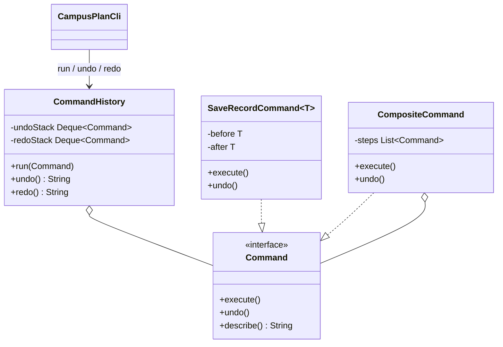
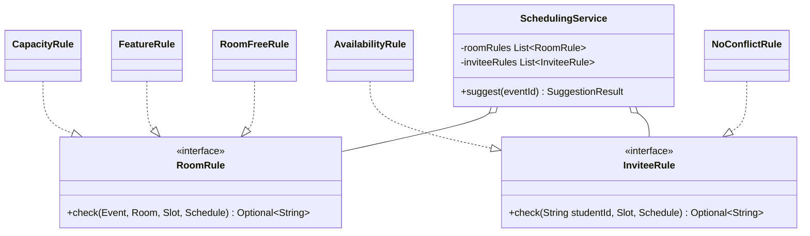

# CampusPlan Design (P1)

This document describes the delivered P1 code (FR-01 to FR-03) and the contracts the team agreed for P2. Every class in section 1 exists in `src/main/java`. Section 2 marks which operations are delivered and which are agreed for later releases.

## 1. Architecture

CampusPlan has four layers, one package each under `com.campusplan`. Dependencies only point downward. `Main` is the only class that knows every layer; it builds the objects and connects them.

| Layer | Package | Responsibility | May depend on |
|---|---|---|---|
| Presentation | `ui` | Read operator input, print results and `Error:` lines | `application`, `domain` |
| Application | `application` | Use-case operations and rules that span several records (unique emails, invitees exist, ID generation, sorting) | `persistence` interfaces, `domain` |
| Domain | `domain` | Immutable records that validate themselves (field limits, interval and merge rules, draft rules) | nothing |
| Persistence | `persistence` | Repository interfaces, in-memory test implementations, and the JSON file store | `domain` |

### 1.1 Class diagram

```mermaid
classDiagram
    direction TB

    namespace ui {
        class CampusPlanCli {
            +run()
        }
        class CorruptDataPrompt {
            +askToSetAside(error, file) boolean
        }
    }

    namespace application {
        class StudentService {
            +create(name, email) Student
            +edit(id, name, email) Student
            +get(id) Student
            +search(query) List~Student~
        }
        class RoomService {
            +list() List~Room~
            +filter(minCapacity, features) List~Room~
        }
        class AvailabilityService {
            +add(studentId, date, start, end) List~AvailabilityInterval~
            +remove(studentId, date, start, end) List~AvailabilityInterval~
            +get(studentId) List~AvailabilityInterval~
            +isAvailable(studentId, date, start, end) boolean
        }
        class EventService {
            +create(details) Event
            +edit(id, details) Event
            +get(id) Event
            +list() List~Event~
        }
        class SeedLoader {
            <<interface>>
            +canLoad() boolean
            +datasets() List~String~
            +load(dataset)
        }
    }

    namespace domain {
        class Student {
            <<record>>
            id
            name
            email
        }
        class Room {
            <<record>>
            id
            name
            capacity
            features
            +hasFeatures(required) boolean
        }
        class RoomFeature {
            <<enumeration>>
            WHITEBOARD
            PROJECTOR
            ACCESSIBLE
        }
        class AvailabilityInterval {
            <<record>>
            date
            start
            end
            +overlaps(other) boolean
            +overlapsOrTouches(other) boolean
            +covers(date, start, end) boolean
        }
        class Availability {
            <<record>>
            studentId
            intervals
            +with(interval) Availability
            +without(interval) Availability
            +isAvailable(date, start, end) boolean
        }
        class EventDetails {
            <<record>>
            title
            inviteeIds
            firstDay
            lastDay
            durationMinutes
            requiredFeatures
            minimumAttendance
        }
        class Event {
            <<record>>
            id
            details
            status
            responses
            +draft(id, details)$ Event
            +withDetails(details) Event
        }
        class EventStatus {
            <<enumeration>>
            DRAFT
            SCHEDULED
            CANCELLED
        }
        class AttendanceResponse {
            <<enumeration>>
            PENDING
            ACCEPTED
            DECLINED
        }
        class ValidationException {
            operator-facing message
        }
    }

    namespace persistence {
        class StudentRepository {
            <<interface>>
            +findAll() List~Student~
            +findById(id) Optional~Student~
            +save(student)
        }
        class RoomRepository {
            <<interface>>
            +findAll() List~Room~
        }
        class AvailabilityRepository {
            <<interface>>
            +findAll() List~Availability~
            +findByStudentId(id) Optional~Availability~
            +save(availability)
        }
        class EventRepository {
            <<interface>>
            +findAll() List~Event~
            +findById(id) Optional~Event~
            +save(event)
        }
        class InMemoryStudentRepository
        class InMemoryAvailabilityRepository
        class InMemoryEventRepository
        class JsonRoomRepository {
            +fromResource(path)$ JsonRoomRepository
        }
        class JsonDataStore {
            +open(file, catalogue)$ JsonDataStore
            +setAside(file)$ Path
            +isEmpty() boolean
            +loadSeed(json)
            +students() StudentRepository
            +rooms() RoomRepository
            +availability() AvailabilityRepository
            +events() EventRepository
        }
        class StorageException {
            operator-facing message
        }
    }

    class Main {
        +main(args)$
    }

    CampusPlanCli --> StudentService
    CampusPlanCli --> RoomService
    CampusPlanCli --> AvailabilityService
    CampusPlanCli --> EventService
    CampusPlanCli --> SeedLoader
    CampusPlanCli ..> ValidationException : catches
    CampusPlanCli ..> StorageException : catches

    StudentService --> StudentRepository
    RoomService --> RoomRepository
    AvailabilityService --> AvailabilityRepository
    AvailabilityService --> StudentService : student exists
    EventService --> EventRepository
    EventService --> StudentService : invitees exist

    Availability "1" *-- "*" AvailabilityInterval
    Event *-- EventDetails
    Event --> EventStatus
    Event --> AttendanceResponse
    EventDetails --> RoomFeature
    Room --> RoomFeature
    Student ..> ValidationException : throws
    Availability ..> ValidationException : throws
    EventDetails ..> ValidationException : throws

    InMemoryStudentRepository ..|> StudentRepository
    InMemoryAvailabilityRepository ..|> AvailabilityRepository
    InMemoryEventRepository ..|> EventRepository
    JsonRoomRepository ..|> RoomRepository
    JsonDataStore ..> StudentRepository : provides
    JsonDataStore ..> RoomRepository : provides
    JsonDataStore ..> AvailabilityRepository : provides
    JsonDataStore ..> EventRepository : provides
    JsonDataStore ..> StorageException : throws

    Main ..> JsonDataStore : opens
    Main ..> CorruptDataPrompt : on StorageException
    Main ..> CampusPlanCli : starts
```



### 1.2 Error handling

There are two exception types. Both are unchecked, and both carry a message written for the operator.

| Exception | Thrown by | Meaning | Handled by |
|---|---|---|---|
| `ValidationException` (domain) | Domain record constructors, `Availability.without`, `Event.withDetails`, services | Input breaks a rule, or an ID does not exist | `CampusPlanCli` prints `Error: <message>` and shows the menu again. Nothing was stored. |
| `StorageException` (persistence) | `JsonDataStore`, `JsonRoomRepository` | A file is missing, corrupt, or could not be written | At startup, `Main` exits for a bad catalogue, or asks `CorruptDataPrompt` about a bad data file. During a session, `CampusPlanCli` prints `Error: <message>`; the store has already undone the change in memory. |

A rejected operation never changes stored data, for two reasons:

- **Validation happens first.** Each operation builds and validates the new immutable record before calling `save`.
- **Failed writes are rolled back.** `JsonDataStore` puts back the previous value if the file write fails.

### 1.3 Ownership of mutable data

- **Domain objects never change.** Every domain object is an immutable Java record. Collections inside records (`inviteeIds`, `requiredFeatures`, `responses`, `intervals`) are copied into unmodifiable collections in the constructor, so a caller cannot change a stored record.
- **The store owns the maps.** `JsonDataStore` and the in-memory repositories own the only mutable maps. `findAll` returns an unmodifiable copy.
- **Services hold no data.** Services keep no state apart from their repository references, so they can be created per test.

### 1.4 Data file

All data is stored in one UTF-8 JSON file, by default `data/campusplan.json`:

```json
{
  "formatVersion": 1,
  "rooms": [ { "id": "R01", "name": "Maple Hall 101", "capacity": 6, "features": ["WHITEBOARD"] } ],
  "students": [ { "id": "S001", "name": "Ada Lovelace", "email": "ada.lovelace@campusplan.example" } ],
  "availability": [ { "studentId": "S001", "intervals": [ { "date": "2026-11-02", "start": "09:00", "end": "11:00" } ] } ],
  "events": [ { "id": "E001", "title": "Capstone project meeting", "inviteeIds": ["S001", "S002"],
                "firstDay": "2026-11-02", "lastDay": "2026-11-04", "durationMinutes": 120,
                "requiredFeatures": ["WHITEBOARD"], "minimumAttendance": 2, "status": "DRAFT",
                "responses": { "S001": "PENDING", "S002": "PENDING" } } ]
}
```

## 2. Interface contracts

These contracts let team members build and test components without waiting for the CLI. Each service can be tested over the in-memory repositories, as the P1 unit tests already do.

The common rules for every operation:

- **IDs:** arguments are trimmed before lookup.
- **Validation failures:** throw `ValidationException` and change nothing.
- **Storage failures:** throw `StorageException` and change nothing.
- **Return values:** every result is an immutable record or an unmodifiable list.

### 2.1 Event planning (delivered in P1, `EventService`)

| Operation | Input | Result | Validation failures (`ValidationException`) |
|---|---|---|---|
| `create(EventDetails)` | Planning fields, already validated by the `EventDetails` constructor | New `Event` with the next ID `E###`, status `DRAFT`, all invitees `PENDING` | An invitee ID is not an existing student. No ID is used up. |
| `edit(String id, EventDetails)` | Existing event ID and the complete new planning fields | Updated `Event` with the same ID and status. Kept invitees keep their response; added ones are `PENDING`. | Unknown ID; event is not `DRAFT`; unknown invitee |
| `get(String id)` | Event ID | The `Event` | Unknown ID |
| `list()` | – | All events, sorted by first day, then ID | – |

`EventDetails` rejects:

- a title that isn't 1–100 characters;
- fewer than 2 or more than 20 invitees, or any repeated invitee;
- a date window that isn't 1–7 days, or that ends before it starts;
- a duration outside 30–180 minutes or not in 30-minute steps;
- a minimum attendance outside 2 to the invitee count.

`AvailabilityService` (also delivered) follows the same pattern: `add`, `remove`, `get` and `isAvailable` each take a student ID, a date, a start time and an end time. `add` and `remove` return the student's merged intervals after the change.

### 2.2 Scheduling (agreed for P2, FR-04 to FR-06)

```java
public record Suggestion(String roomId, LocalDate date, LocalTime start, LocalTime end,
                         List<String> eligible, Map<String, String> ineligibleReasons) { }

public record SuggestionResult(List<Suggestion> top, int rejectedForRoom, int rejectedForAttendance) { }

public class SchedulingService {
    SuggestionResult suggest(String eventId);
    Event confirm(String eventId, Suggestion chosen);
    Event cancel(String eventId);
    Event respond(String eventId, String studentId, AttendanceResponse response);
}
```

| Operation | Input | Result | Validation failures |
|---|---|---|---|
| `suggest` | ID of a `DRAFT` event | Up to 5 suggestions, ranked by eligible count (highest first), then date and time, then fewest unused seats, then room ID. If none qualify, `top` is empty and both rejection counts are set; a candidate that fails a room rule counts only as a room rejection. | Unknown event; event is not `DRAFT`. The result is read-only and reserves nothing. |
| `confirm` | Event ID and a suggestion previously returned | Event with status `SCHEDULED`, its room and time, and the room reserved | The suggestion is no longer valid when checked again (room taken, attendance below minimum). Rejected with no change. |
| `cancel` | ID of a `SCHEDULED` event | Event with status `CANCELLED`, reservation released, responses kept | Event is not `SCHEDULED`. The CLI asks for confirmation before calling this. |
| `respond` | Event ID, student ID, response | Event with the updated response | `ACCEPTED` when the student lacks full availability or has accepted an overlapping scheduled event; student is not an invitee |

**Data ownership:** `SchedulingService` reads students, rooms, availability and events through the repositories and writes events only through `EventRepository.save`. `Suggestion` and `SuggestionResult` are immutable records owned by the caller.

`Event` gains nullable fields `roomId`, `date`, `start` and `end`, which are set only when the status is `SCHEDULED`. The data file format version goes to 2, and version 1 files still load, with those fields empty.

### 2.3 Storage (delivered in P1)

| Operation | Contract |
|---|---|
| `XRepository.findAll()` | Unmodifiable list in insertion order. Never null. |
| `XRepository.findById(id)` | `Optional.empty()` if the ID is unknown. Never throws for an unknown ID. |
| `XRepository.save(record)` | Inserts the record, or replaces the one with the same ID. Assumes the record is valid. With `JsonDataStore` it writes the file before returning. On a write failure it throws `StorageException`, restores the previous value, and leaves the old file intact. Saving an unchanged record writes nothing. |
| `JsonDataStore.open(file, catalogue)` | Missing file: an empty store with the catalogue rooms, and no file is written. Invalid file: throws `StorageException` naming the file, the line and column, and the problem; the file is not changed. |
| `JsonDataStore.setAside(file)` | Renames the file to `<name>.corrupt-<timestamp>` with its contents unchanged and returns the new path. |
| `JsonDataStore.loadSeed(json)` | Only into an empty store (otherwise `ValidationException`). Corrupt seed data throws `StorageException` and leaves the store empty. |

**Parallel work:** a P2 developer can test against `InMemory*Repository` (unit tests) or `JsonDataStore` in a JUnit `@TempDir` (integration tests) without touching the CLI.

### 2.4 Undo and redo (agreed for P2, FR-08)

```java
public interface Command {
    void execute();    // performs the change; throws ValidationException or StorageException and changes nothing on failure
    void undo();       // restores exactly the state before execute()
    String describe(); // shown to the operator, e.g. "Add student S013"
}

public class CommandHistory {
    void run(Command command); // execute; on success push onto undo stack and clear redo stack
    String undo();             // undo the latest command, move it to the redo stack; returns its description
    String redo();             // execute again, move it back to the undo stack
    boolean canUndo();
    boolean canRedo();
}
```

| Rule | Contract |
|---|---|
| Successful mutations | Every successful create, edit, availability change, confirmation, cancellation and response goes through `CommandHistory.run`. |
| Failed operations and exports | A command that throws is not added to history. Exports, seed loading and read-only operations never enter history. |
| Capacity | At least 20 operations can be undone. |
| New mutation after undo | Clears the redo stack. |
| Nothing to undo or redo | `undo()` or `redo()` throws `ValidationException("Nothing to undo.")` (or "Nothing to redo."). |
| Saving | Each `execute` and `undo` saves through the repositories, so quitting after an undo keeps the restored state. History itself is not saved. |
| Ownership | A command keeps the immutable records from before and after the change. Because records never change, keeping references is safe. |

## 3. Design patterns

### 3.1 Command: reversible operations (planned for P2)

**Problem.** FR-08 needs undo and redo for every successful change, including changes that touch several records at once. Confirming a suggestion changes the event and reserves a room, and both must be restored together. Without a pattern, each CLI handler would need its own undo code, and history would be scattered across the UI.



| Item | Detail |
|---|---|
| Participants | `Command` (interface), `CommandHistory` (invoker), concrete commands such as `SaveRecordCommand` and `CompositeCommand`, the repositories (receivers), `CampusPlanCli` (client). Planned files: `application/command/*.java`. |
| Collaboration | The CLI asks a service for the new record, wraps the change in a command and passes it to `CommandHistory.run`. `undo()` calls the command's `undo`, which saves the `before` record again. |
| Benefits | One undo and redo mechanism for every operation. Multi-record changes are undone atomically through `CompositeCommand`. Undo is easy to test without the CLI. Immutable records make `before` and `after` snapshots cheap and safe. |
| Costs | One more class per kind of change. Every mutation has to be routed through the history, so a forgotten route breaks undo silently. Tests must cover every route. |
| Simpler alternative | Snapshot the whole store before each change and restore it on undo (Memento). It's simpler, but it copies all data for every change and can't describe what is being undone. We may still use it inside `CompositeCommand` if per-record undo becomes complex. |
| Planned tests | `CommandHistoryTest`: undo after a create, redo after undo, new mutation clears redo, 20+ operations, failed command not recorded. `ScheduleUndoTest`: undoing a confirmation restores DRAFT status and frees the room. |

### 3.2 Strategy: scheduling candidate rules (planned for P2)

**Problem.** FR-04 needs every rejected candidate, and every ineligible invitee, to be explained ("room holds 5, event invites 6", "not available 13:00–15:00", "already accepted E002"). Room failures must be counted before attendance failures. CR-01 in P3 will add room closures as a new reason. Writing all the checks in one long method would mix the rules with the ranking and make each new rule an edit to that method.



| Item | Detail |
|---|---|
| Participants | `RoomRule` and `InviteeRule` (strategy interfaces); concrete rules `CapacityRule`, `FeatureRule`, `RoomFreeRule`, `AvailabilityRule`, `NoConflictRule`; `SchedulingService` (context). Planned files: `application/scheduling/*.java`. |
| Collaboration | For each candidate, `SchedulingService` applies the room rules in order. The first failure gives the room rejection reason. If the room passes, it applies the invitee rules to each invitee to build the eligible list and the ineligible reasons, then ranks the valid candidates. |
| Benefits | Each rule is small and unit-tested on its own, including boundary cases. The reasons shown to the organizer come straight from the rules. CR-01 adds a `ClosureRule` without changing the ranking code. The order of the list fixes the "room failures first" counting rule. |
| Costs | Five or six small classes instead of one method, and an extra layer to follow when reading `suggest`. Rules must not depend on each other. |
| Simpler alternative | One `suggest` method with an if-chain per rule. It's fine for a fixed rule set, but every new rule (closures in P3) edits the most complex method, and the reasons have to be built by hand in several places. |
| Planned tests | One test class per rule with boundary values (capacity equal to invitees, adjacent 13:00–14:00 and 14:00–15:00). `SchedulingServiceTest` covers the brief's acceptance table: five of six eligible, minimum six, room too small, accepted elsewhere, and the tie-break order. |

### 3.3 Patterns already in the P1 code

- **Repository.** The `StudentRepository`, `RoomRepository`, `AvailabilityRepository` and `EventRepository` interfaces hide storage from the services, with in-memory and JSON implementations. The brief requires this, so it is not counted as one of the two patterns above.
- **Immutable value objects.** All domain records are immutable. This is what makes the planned Command snapshots safe.

## 4. Architecture decision records

### ADR-001: Keep business rules out of the user interface

| | |
|---|---|
| **Status** | Accepted (P1) |
| **Context** | The brief requires that core rules be testable without the UI (NFR-04) and that input handlers delegate business operations. The team may move from the CLI to a graphical interface later. Several members implement features in parallel, and the CLI is the last thing integrated. |
| **Alternatives** | 1. Validate and store directly in the CLI handlers. It's the fastest to write, but rules can only be tested by scripting the CLI, and a GUI would duplicate them. 2. Use a UI framework with built-in binding and validation (JavaFX properties). This ties the rules to the framework. 3. Four layers, with rules in self-validating domain records and services (chosen). |
| **Decision** | Use four packages: `ui`, `application`, `domain` and `persistence`. Field rules live in the domain record constructors, so an invalid record cannot exist. Rules that span records live in the services. The CLI only parses text (dates, numbers, comma lists), calls a service and prints the result or the `Error:` message. |
| **Consequences** | Every rule is covered by unit tests that never start the CLI. A GUI could reuse every service unchanged. Parsing text (for example "9am") is still the CLI's job, so the acceptance tests cover those messages. There are more classes than in a CLI-only design. |
| **Validation evidence** | `StudentServiceTest`, `AvailabilityServiceTest` and `EventServiceTest` run without the UI. The domain package has no `java.io` or `java.nio` imports. Domain coverage is 98.2% and application coverage 96.8% of lines (`docs/test-report/coverage/`). The CLI acceptance tests drive the same services through text input. |

### ADR-002: One versioned JSON file, atomic saves, fail closed on bad data

| | |
|---|---|
| **Status** | Accepted (P1) |
| **Context** | FR-03 and NFR-05 require that data survive restarts and that a failed save never silently discards the previous valid file. A corrupt file must produce a clear error and must not be overwritten. P3 (CR-01) must load P2 files, so the format needs a version. Seed data loads only into an empty application. |
| **Alternatives** | 1. One file per collection. Each write is smaller, but a crash between files can leave students and events out of step. 2. An embedded database (H2 or SQLite). It's transactional, but it adds a dependency, the brief asks for JSON, and it's harder to inspect. 3. Save only when quitting. It's simple, but a crash loses the whole session. 4. One JSON file holding everything, rewritten after each change through a temporary file and an atomic move (chosen). |
| **Decision** | `JsonDataStore` holds all data and provides the repository interfaces. Every `save` writes `campusplan.json.tmp` and then moves it over `campusplan.json`. If the write fails, the in-memory change is undone and `StorageException` is thrown. Loading validates every record and cross-reference and rejects unknown format versions without changing the file. The operator may then set the file aside (renamed, never deleted) after typing YES. |
| **Consequences** | A crash leaves either the old or the new file, never a half-written one. Every change rewrites the whole file, which is acceptable for the brief's sizes (about 100 events). Validating on load means a hand-edited file with one bad record is refused, not partly loaded. `formatVersion` lets P3 migrate P2 files. |
| **Validation evidence** | `JsonDataStoreTest`: round trip with the same IDs, UTF-8 names, corrupt, empty, cut-off and newer-version files rejected byte-for-byte unchanged, failed save keeps the previous file, interrupted save ignored, unchanged save not written, set-aside keeps identical contents. `CampusPlanCliPlanningAcceptanceTest#demoSliceSurvivesRestart`. |

### ADR-003: Command pattern for undo and redo

| | |
|---|---|
| **Status** | Proposed (P1), to be implemented in P2 |
| **Context** | FR-08 needs undo and redo of at least 20 successful operations in a session, restoring related data and reservations together. A new mutation after an undo clears redo. Failed operations and exports are not recorded. Saving after an undo must keep the restored state. The domain records are already immutable. |
| **Alternatives** | 1. Memento: copy the whole store before each change. It's simple and always correct, but it costs memory and time for every change and has no description to show ("Undo: add student S013"). 2. Inverse operations written by hand per feature (for example delete for add). This needs a reverse for every operation, and some changes have none, because physical deletion is out of scope. 3. Command objects that keep the immutable before and after records, with a composite for multi-record changes (chosen). |
| **Decision** | Use a `Command` interface (`execute`, `undo`, `describe`) and a `CommandHistory` with undo and redo stacks, as specified in section 2.4. Undo saves the `before` records through the same repositories, so the file is updated. A `CompositeCommand` groups the steps of one user action, for example scheduling an event and reserving its room, and undoes them in reverse order. |
| **Consequences** | Each mutation needs a command, which is more classes. Because records are immutable, a command only keeps references, so 20+ operations cost almost no memory. Undo goes through the normal save path, so a failed save during undo is reported like any other storage error. |
| **Validation evidence** | Planned for P2: `CommandHistoryTest` (undo after create, redo after undo, mutation clears redo, 20-operation limit, failed command not recorded) and an undo-after-scheduling test. The P1 tests already show that records are immutable (`EventTest`, `AvailabilityTest`) and that every save is written straight to disk (`JsonDataStoreTest#roundTripsAllData`). |
