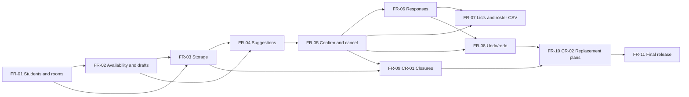

# CampusPlan Project Plan

Fill in every `[Member X]` placeholder with a team member's name before exporting to `plan.pdf`. Use the same letter for the same person throughout.

## 1. Team, roles and working agreement

### 1.1 Roles per iteration

The brief requires coordination and release duties to rotate between iterations. Each member owns at least one feature through implementation, tests and integration, and reviews at least one teammate pull request per iteration.

| Role | P1 (weeks 1-3) | P2 (weeks 4-6) | P3 (weeks 7-9) |
|---|---|---|---|
| Coordinator (meetings, issue board, TA contact) | [Member A] | [Member B] | [Member C] |
| Release manager (tag, `release.txt`, zip, demo video) | [Member B] | [Member C] | [Member A] |
| Requirements and traceability owner | [Member C] | [Member A] | [Member B] |

| Feature ownership | Owner | Reviewer |
|---|---|---|
| FR-01 Students and room catalogue | [Member A] | [Member B] |
| FR-02 Availability and draft events | [Member B] | [Member A] |
| FR-03 Storage and sample data | [Member B] | [Member C] |
| FR-04 Suggestions (Strategy rules) | [Member C] | [Member A] |
| FR-05 Confirm and cancel | [Member A] | [Member C] |
| FR-06 Responses | [Member B] | [Member C] |
| FR-07 Event lists and roster CSV | [Member C] | [Member B] |
| FR-08 Undo/redo (Command) | [Member A] | [Member B] |
| FR-09 CR-01 Closures and migration | [Member B] | [Member A] |
| FR-10 CR-02 Replacement plans | [Member C] | [Member A] |
| FR-11 Final integration, user guide | All, led by the P3 release manager | - |

### 1.2 Working agreement

- **Communication.** The team uses one group chat for day-to-day questions and a weekly meeting with notes in the repository (decisions and action items). Blockers are raised in the chat the same day and reported to the TA within two teaching days if unresolved.
- **Issues.** Every feature, defect and TA finding is a GitHub issue with acceptance criteria and an owner. Issues move through To do, In progress, In review and Done.
- **Branches and pull requests.** One feature branch per issue (`feat/FR-xx-...`, `fix/...`, `docs/...`). Every change goes through a pull request that links the issue, summarizes the change and its design impact, and includes the `./mvnw test` command and result. `main` is protected against direct pushes.
- **Code review.** At least one teammate other than the author approves each pull request. The reviewer checks correctness, requirement coverage, architecture (layer rules in `design.md`), tests and readability, and writes specific comments or a short approval rationale. The author fixes blocking comments before merge. An AI review never replaces the human approval.
- **Integration.** Pull requests are kept small (one feature slice). Before merging, the author rebases on `main` and runs the full suite. Shared contracts in `design.md` section 2 change only through a pull request that every member reviews.
- **AI use.** Each member records their own AI use in `attribution.md` (date, tool, task, prompt summary, output used, files, changes, verification) and links it in the pull request. Each member must be able to explain every line they submit.
- **Conflict resolution.** Technical disagreements are settled by a written comparison in the issue (options, trade-offs), then a vote. Ties go to the feature owner. Unresolved process or contribution problems go to the TA, and contribution disputes go privately to the instructor.
- **Worklogs.** Each member updates their private `worklog.csv` weekly (date, task_id, contribution, evidence_link, minutes, outcome).

## 2. Backlog

Priority follows the brief: every baseline FR and both change requests are mandatory, so priority sets the order of work, not whether it is done. **Must (P1)** is the first vertical slice. **Must (P2)** is the baseline. **Must (P3)** is the change requests and hardening.

### 2.1 Functional requirements

| ID | Release | Priority | Summary | Acceptance criteria (measurable) | Status |
|---|---|---|---|---|---|
| FR-01 | P1 | Must (P1) | Create, edit, view and search students; list and filter rooms | AC-02.1 to AC-02.23 and AC-03.1 to AC-03.12 in `Requirements.pdf`. Duplicate emails are rejected ignoring case and spaces. Filtering for capacity 6 with a whiteboard gives R01, R02, R04 and R06. | Done |
| FR-02 | P1 | Must (P1) | Enter and update availability; create, edit and view draft events | AC-04.1 to AC-04.15 and AC-05.1 to AC-05.15, AC-06.1 to AC-06.11. Intervals are on 30-minute boundaries within 08:00-22:00, merged, half-open. Drafts enforce title 1-100, 2-20 distinct invitees, window 1-7 days, duration 30-180 in 30-minute steps, and minimum attendance from 2 to the invitee count. | Done |
| FR-03 | P1 | Must (P1) | Save and reload all data, missing and corrupt storage, sample data | AC-01.1 to AC-01.18 and AC-07.1 to AC-07.8. IDs survive restart. A corrupt file is never overwritten. A failed save keeps the previous file. Two sample datasets: one with a valid suggestion, one with none. | Done |
| FR-04 | P2 | Must (P2) | Top five explained scheduling suggestions | Each brief section 3 acceptance example passes as a JUnit test: five of six eligible with minimum 4 returns that candidate with the reason for the sixth; minimum 6 excludes it; a room for 5 is excluded for 6 invitees; adjacent 13:00-14:00 and 14:00-15:00 are allowed; an overlapping ACCEPTED commitment excludes the student; ties follow the published order the same way in 10 of 10 runs. The no-result case shows separate room and attendance rejection counts. | Planned |
| FR-05 | P2 | Must (P2) | Confirm a suggestion with revalidation; cancel with confirmation | A stale suggestion (room taken after the suggestion was shown) is rejected and the stored data is unchanged. Confirming sets SCHEDULED and reserves the room. Cancel asks for confirmation; declining changes nothing; cancelling keeps the record and responses and frees the room; a cancelled event cannot be scheduled again. | Planned |
| FR-06 | P2 | Must (P2) | Record PENDING, ACCEPTED and DECLINED responses | ACCEPTED is rejected without full availability or with an overlapping ACCEPTED event. DECLINED and PENDING release a commitment. An availability edit that would invalidate an ACCEPTED response is rejected and names the affected events. Responses and eligible counts are shown separately. | Planned |
| FR-07 | P2 | Must (P2) | List events by date and status; roster CSV export | The list is filterable by date and status. The export writes UTF-8 CSV with header `student_id,name,email,response`. A name containing a comma, a quote or a line break round-trips through a CSV parser. | Planned |
| FR-08 | P2 | Must (P2) | Undo and redo | 20 successive operations can be undone, then redone. A new mutation after undo clears redo. Failed operations and exports are not recorded. Undoing a confirmation restores DRAFT and frees the room. Saving after undo persists the restored state. | Planned |
| FR-09 | P3 | Must (P3) | CR-01 room closures and affected events | Duplicate closures are rejected; overlapping closures behave as their union; removing a closure works. SCHEDULED events overlapping a closure show NEEDS_REPLAN while keeping SCHEDULED status, and the flag clears when the last closure is removed. A retained P2 file loads without edits, keeping all IDs and responses, and is backed up before the first migrated save. | Planned |
| FR-10 | P3 | Must (P3) | CR-02 preview and confirm replacement plans | Alternatives use the original constraints, exclude the current room and time, and ignore only this event's own reservation. The preview lists the old and new plan, students losing eligibility and responses that would reset. A date or time change resets responses to PENDING; a room-only change keeps them. Cancelling the preview or failing revalidation changes nothing. Undo restores the whole previous plan and history. | Planned |
| FR-11 | P3 | Must (P3) | Integrated release, clear errors, user guide, repeatable build | A fresh clone builds and passes all tests with `./mvnw verify`. `user_guide.pdf` covers every menu option. `known_issues.csv` lists remaining defects with severity. | Planned |

### 2.2 Non-functional requirements (brief)

The brief's NFR IDs are the course's. `Requirements.pdf` refines them into the team's NFR-01 to NFR-14; the last column shows where each brief NFR is covered.

| Brief ID | Release | Priority | Requirement | Acceptance criteria (measurable) | Team NFRs | Status |
|---|---|---|---|---|---|---|
| NFR-01 | P1 | Must | Build and tests run from a clean clone with the documented Maven Wrapper commands | Two members clone into an empty folder with only JDK 21 installed and run `./mvnw test` (`mvnw.cmd test` on Windows): 0 failures, done before each release tag | Team NFR-08, NFR-13 | Partial: passes on Windows 11 with JDK 21; fresh-clone check before tagging |
| NFR-02 | P1 | Must | Invalid mutations preserve existing records and reservations | Every rejection test compares stored data before and after (100% of rejection cases in `Requirements.pdf` section 2) | Team NFR-01, NFR-02 | Pass for P1 operations |
| NFR-03 | P2 | Must | Suggestions for 20 invitees, 20 rooms, a 7-day window and 100 existing events finish within 2 seconds | A JUnit timing test over a generated dataset, 10 runs, every run under 2 s on the documented test machine (startup excluded) | Team NFR-07 | Planned |
| NFR-04 | P1 | Must | Application operations can be tested without the UI | All service tests run without the CLI; domain and application line coverage at least 80% | Team NFR-11, NFR-12 | Pass: domain 98.2%, application 96.8% |
| NFR-05 | P1 | Must | Data survives a normal restart; a failed save reports an error without discarding the previous valid file | `JsonDataStoreTest#roundTripsAllData`, `#failedSaveKeepsPreviousFile`, `#interruptedSaveLoadsLastCompleteSave`; `CampusPlanCliPlanningAcceptanceTest#demoSliceSurvivesRestart` | Team NFR-03, NFR-09 | Pass |

Team NFRs not covered by a brief ID (usability and output quality): NFR-04 first-time users, NFR-05 short error messages, NFR-06 the CLI never crashes, NFR-10 repeatable output, NFR-14 no network and fictional data. These are scheduled in P2 (see section 3).

## 3. Schedule

Project launch: Monday 5 October 2026. Releases: P1 due 24 October, P2 due 16 November, P3 due 9 December 2026, each at 11:59 PM.

| Week | Dates | Work | Owner(s) | Done when |
|---|---|---|---|---|
| 1 | 5-11 Oct | Team agreement, client Q&A (at least 5 questions), backlog, repository and build skeleton | [Member A], all | Questions and answers recorded; `./mvnw test` passes on `main` |
| 2 | 12-18 Oct | Use cases and acceptance criteria (`Requirements.pdf`), interface contracts, diagrams, first three ADRs, risks | [Member C], [Member A] | `Requirements.pdf` and `design.md` drafted and reviewed |
| 3 | 19-24 Oct | FR-01 to FR-03 vertical slice, sample data, traceability, test report, retrospective, P1 demo video | [Member A] FR-01, [Member B] FR-02 and FR-03, [Member C] docs | All P1 tests pass, tag `p1`, `p1.zip` and `p1_demo.mp4` submitted |
| 4 | 26 Oct-1 Nov | Act on P1 feedback; TA design checkpoint (5 minutes: components, two patterns, a working feature, top integration risk); scheduling rules (Strategy) and `SchedulingService.suggest` | [Member C] FR-04, [Member B] P1 fixes | Each TA finding has an action recorded in its issue; rule classes unit-tested |
| 5 | 2-8 Nov | FR-04 ranking and explanations, FR-05 confirm and cancel, FR-06 responses, `CommandHistory` | [Member C], [Member A], [Member B] | Brief section 3 acceptance table passes as tests |
| 6 | 9-16 Nov | FR-07 lists and CSV, FR-08 undo/redo across all mutations, NFR-03 timing test, full regression, `pattern_catalogue.pdf`, `changelog.md`, P2 demo, retain a P2 JSON sample | [Member C] FR-07, [Member A] FR-08, [Member B] release | All P2 tests pass, tag `p2`, `p2.zip` and `p2_demo.mp4` submitted |
| 7 | 17-23 Nov | Change-impact analysis for CR-01 and CR-02, revised acceptance criteria, migration approach, updated ADR | [Member A] coordinator, all | Week 7 documents submitted |
| 8 | 24-30 Nov | FR-09 closures and P2 file migration; FR-10 preview, confirm and undo; regression | [Member B] FR-09, [Member C] FR-10 | Migration and failed-reschedule rollback tests pass |
| 9 | 1-9 Dec | Acceptance testing, user guide, known issues, final retrospective, group and individual demos | [Member A] release, all | Tag `p3`, `p3.zip` and all videos submitted |

## 4. Risks

Scores are 1 (low) to 3 (high). The top five are ordered by likelihood times impact.

| # | Risk | Likelihood | Impact | Mitigation | Owner |
|---|---|---|---|---|---|
| R1 | Scheduling rules (FR-04 to FR-06) are misread: tie-break order, half-open boundaries, room failures counted first, ACCEPTED conflicts | 3 | 3 | Turn every brief section 3 example into a JUnit test before coding. Use one rule class per check (Strategy) so each boundary is tested on its own. Ask the TA about anything unclear and record the answer in the issue. | [Member C] |
| R2 | Undo/redo misses an operation or restores only part of a multi-record change (event plus reservation) | 2 | 3 | Every mutation goes through `CommandHistory` (contract in `design.md` 2.4). Use a composite command for multi-record actions. Add a test per mutation type, plus undo after scheduling. | [Member A] |
| R3 | P3 cannot load P2 files or loses responses during migration | 2 | 3 | `formatVersion` is in the file from P1. Keep the P2 sample file in the repository at the `p2` tag. Write a migration test from that exact file before changing the format. | [Member B] |
| R4 | Integration conflicts and late merges near deadlines (P1 work was merged in the last days) | 3 | 2 | Small pull requests merged at least twice a week. Shared contracts change only by reviewed pull request. A feature freeze two days before each release. | Coordinator of the iteration |
| R5 | Environment differences break the build for someone (P1: a member's default JDK was 17, but the project needs 21) | 2 | 2 | README states JDK 21 and how to set `JAVA_HOME`. Two members run the fresh-clone check before every tag. Dependency versions are pinned in `pom.xml`. | Release manager of the iteration |

Other risks being watched: AI-generated code that a member cannot explain at the individual demo (mitigation: author explains each pull request in its description and in review); the documentation drifting from the code (mitigation: the traceability owner updates `traceability.csv` in the same pull request as the code).

## 5. Dependencies

### 5.1 Between requirements

- **FR-04** needs availability and drafts (FR-02) and the stored data (FR-03).
- **FR-05** needs FR-04's `Suggestion` type, and adds the room and time fields to `Event` (data format version 2).
- **FR-08** must wrap every mutation, so it is integrated after FR-05 and FR-06 exist. The `Command` contract is fixed in week 4 so they can be written to fit it.
- **FR-09** needs the P2 data format frozen at the `p2` tag. FR-10 reuses FR-04's rules (adding a closure rule) and FR-08's history.

### 5.2 External

| Dependency | Version | Used for |
|---|---|---|
| JDK | 21 | Language level (`maven.compiler.release` 21) |
| Maven Wrapper | Maven 3.10.0 | Build without a local Maven install |
| Jackson Databind | 2.18.2 | JSON reading and writing |
| JUnit Jupiter | 5.11.4 | Tests |
| JaCoCo | 0.8.12 | Coverage report |

## 6. Retrospectives

### 6.1 P1 retrospective

Held on: [date]. Present: [names].

**Facts from P1 to discuss** (from the repository history):

- The repository was created on 20 October. FR-01 was merged on 25 October, and FR-02 and FR-03 were implemented on 27 October, after the 24 October due date.
- Checking the code against `Requirements.pdf` late in P1 found ten acceptance criteria the code did not yet meet. All were fixed before release, and one requirement (reset to sample data) was removed because it contradicted the brief.
- One defect was found by running the real application rather than the tests: piped input starting with a byte-order mark shifted every menu answer. It was fixed with a regression test.
- A member's default JDK was 17, while the project needs 21.
- The `issue` column of `traceability.csv` is empty because work was not tracked in GitHub issues.

| What went well | What did not go well | Action for P2 | Owner | Due |
|---|---|---|---|---|
| [team to fill] | [team to fill] | [team to fill] | [Member X] | [date] |
| | | | | |
| | | | | |

### 6.2 P2 retrospective

To be completed at the end of week 6.

### 6.3 Plan updates after P1

Record here how the plan changed after the retrospective (for example new owners, moved dates, new risks).
